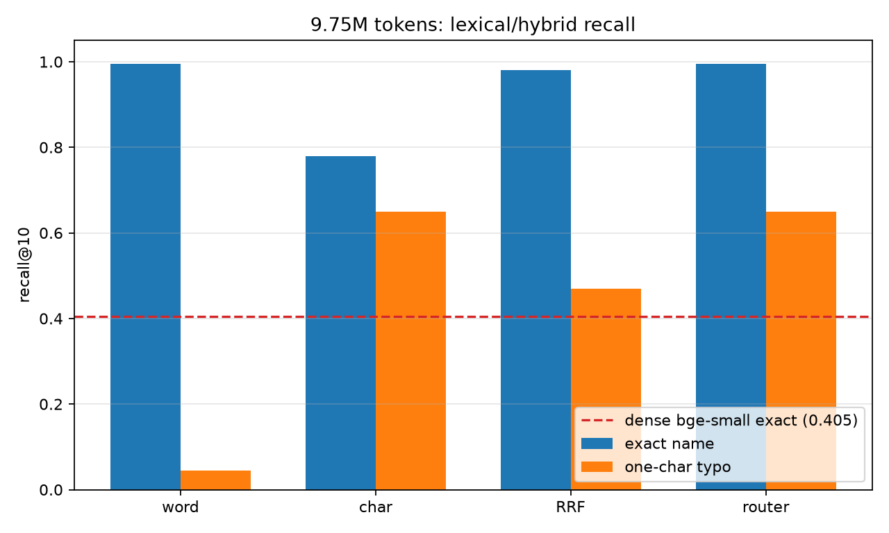

# Lexical/hybrid follow-up: the locator is viable at 44 B/token

**Store:** 76,145 chunks / 9,746,560 content tokens, 200 queries  
**Budget:** 64 B/token allowed; combined total is **44.32 B/token** (40.32 locator + 4 base)  
**Metric:** exact gold chunk in top-k; same-noun top-1 is a wrong-project fact

## Executive summary

- **Dense-only was the wrong tool.** `bge-small` flat int8 gets recall@10 **0.405** at 9.75M; the same store with word BM25 gets **0.995**.
- **Exact-name queries are essentially solved by lexical retrieval.** Word BM25: r@1 **0.980**, r@10 **0.995**, r@50 **1.000**, at **3.09 B/token**.
- **A single-character typo breaks exact BM25** (r@10 **0.045**), but a character 2–3-gram index recovers **0.650** at r@10.
- **The router gets both:** exact **0.995**, typo **0.650** at r@10, for **44.32 B/token total** — under the 64 B/token budget. Same-noun top-1 drops from **0.795** (dense) to **0.020** (router exact).
- **Verdict:** the idea is possible **for queries that name the entity**. It is not solved for pronouns, paraphrases without the name, or multi-turn references; those need a dense/query-rewrite fallback. But the 0.405 ceiling was a dense-retrieval artifact, not a property of the task.

## Results at 9.75M tokens

| retriever | exact r@1 | exact r@10 | exact r@50 | typo r@1 | typo r@10 | typo r@50 |
|---|---:|---:|---:|---:|---:|---:|
| dense bge-small | 0.125 | 0.405 | 0.695 | — | — | — |
| word BM25 | 0.980 | 0.995 | 1.000 | 0.010 | 0.045 | 0.355 |
| char 2-3gram | 0.560 | 0.780 | 0.910 | 0.430 | 0.650 | 0.805 |
| RRF word+char | 0.790 | 0.980 | 1.000 | 0.045 | 0.470 | 0.790 |
| router | 0.980 | 0.995 | 1.000 | 0.430 | 0.650 | 0.805 |

The typo condition replaces the project name with a last-two-character swap (`Groth` → `Groht`) in every query. The gold fact is unchanged.

**No-name sanity check:** with the project name removed (`what is the access code for the project?`), word BM25 gets r@10 **0.045** and char n-gram gets **0.010**; same-noun top-1 is **0.990**. The query is genuinely ambiguous among ~136 same-noun facts. Lexical retrieval only works when the entity is named.

## Storage

| component | MB | B/token |
|---|---:|---:|
| word BM25 | 30.1 | 3.09 |
| char 2-3gram TF-IDF | 362.9 | 37.23 |
| **locator combined** | **393.0** | **40.32** |
| base token IDs + blank flag | 39.0 | 4.00 |
| **total without dense** | **432.0** | **44.32** |
| + dense bge-small | 68.2 | 7.00 |
| **total with dense** | **500.2** | **51.32** |
| budget | | 64.00 |

The char index estimate is `nnz × 8 B + 2^20 × 4 B` for a hashed CSR matrix; the word BM25 estimate is `postings × 5 B + vocabulary × 24 B`. Both are in-memory estimates, not compressed on-disk sizes. Even with dense bge-small added, the total is ~51 B/token, leaving ~13 B/token of headroom.

## Method

1. Build word BM25 over the modified chunks (`k1=1.2`, `b=0.75`, token pattern `[a-z0-9]+`).
2. Build a hashed character 2–3-gram TF-IDF index (`2^20` features, sublinear TF, L2).
3. Route each query: if the project-name token exists in the word index (`df > 0`), use word BM25; otherwise use the character index. This is a proxy for “rare entity is present”; in production it would be an NER/query-analysis step.
4. Return top-50 and score exact gold-chunk recall.

## Why this works

The facts contain unique random project names (`Groth`, `Pathkiath`, ...). Dense bge-small does not represent those rare names sharply, so it ranks many same-noun facts together. BM25 matches the rare name exactly and collapses the candidate set. The character index handles the case where the name is misspelled and the exact token is absent.

## Caveats

- **Synthetic, template queries.** All 200 queries contain the exact project name and noun. Real questions may say “it”, “that project”, or omit the name; those are ambiguous without conversation state.
- **One typo model.** A last-two-character swap; other typos, transliterations, and aliases may behave differently.
- **No real-data evaluation.** The corpus is real Discord chatter, but the facts and questions are synthetic. The next test should use real questions with entity mentions.
- **Character index is memory-heavy.** 37.23 B/token is most of the budget; it can be quantized or replaced with a smaller n-gram/fuzzy index.
- **Router is a proxy.** It assumes the entity name can be extracted from the query; a real system needs NER or query rewriting.

## Next steps

1. Add dense bge-small as a fallback when no rare name is present (still under 64 B/token).
2. Add a cross-encoder reranker over the top-50; query-time only, no storage cost.
3. Test real user questions and multi-turn references; measure how often the entity name is present.
4. If real queries often omit names, add a conversation-state resolver that expands “it/that project” to a candidate entity before retrieval.

## Files

- `hybrid_results.json` — router/word/char/RRF recall.
- `bm25_results.json` — word BM25 exact/typo.
- `char_ngram_results.json` — char index exact/typo.
- `hybrid_quality.png` — recall@10 plot.
- `hybrid_report.md` — this report.