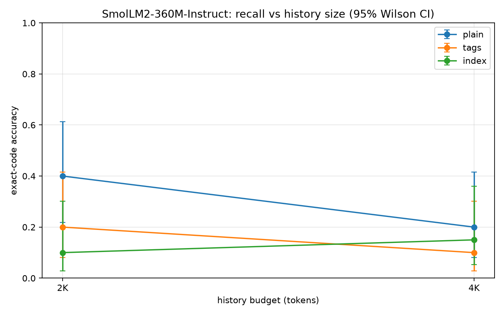

# Small-LLM history recall: plain text vs tags vs compact index

**Date:** 2026-11-01  
**Model:** `HuggingFaceTB/SmolLM2-360M-Instruct` (360M params, fp16, 8K context)  
**Task:** chat normally and answer questions from a long in-context history  
**History:** synthetic facts + real Discord chatter; 20 questions per cell at 2K/4K  
**Metric:** exact code match; 95% Wilson CI; paired McNemar exact test

## Executive summary

- **Plain natural language is the best quality/size tradeoff in this pilot.** At 2K tokens, plain gets 0.40 vs 0.20 for inline tags and 0.10 for the compact index. At 4K: plain 0.20, tags 0.10, index 0.15.
- **Tags do not help this model.** Inline XML tags add tokens and are often echoed or ignored; the compact index uses fewer tokens but is not consistently better. The paired differences are not statistically robust at these sample sizes, but nothing favours tags.
- **The 360M reader is not reliable.** Best accuracy in any cell is 0.40 (2K, plain). The model chats coherently but confuses codes, invents 8-character codes, and sometimes repeats itself. This is a model-size/quality limit, not a tag-format limit.
- **Prompt processing is not 'instant' on this hardware.** A preliminary prefill measurement of 1.8s at 2K plain (1180 tok/s) was taken on a shared GPU and is contended, not a clean benchmark, but it is already seconds, not milliseconds. Generation and memory are the practical constraints at 4K+; the 6K run was stopped after 14 minutes without completing 10 questions, and 8K overflowed the prompt.
- **Verdict:** for a ~360M reader, **go without tags**: plain text has the best accuracy and fewer bytes than inline tags. But the absolute recall is far below a usable bar; a larger reader (0.5B–1B) or a trained reader/locator is required before this is a product.

## Method

1. Use the same 200 facts as the locator test. For the planned 2K/4K/6K histories, include the first 20/40/60 fact needles and their 3 designated distractors (80/160/240 facts); only 2K/4K completed.
2. Build three histories at each size: **plain** natural-language facts, **inline tags** (`<fact project=... noun=... code=.../>`), and a **compact index** (`project=... | noun=... | code=...`). The facts and questions are identical; only the representation changes.
3. Mix the facts with real corpus lines as filler and shuffle. Keep the total history near the target; the tag/index conditions get the same total budget, not extra facts.
4. Ask the same questions; greedy decode up to 24 tokens (20 at 6K); exact-match the code after removing punctuation. No repetition penalty: the answer is in the context, so penalising repeated tokens suppresses the gold code (this was verified).
5. Measure accuracy, wrong-code rate, don't-know rate, generation time, and prefill latency.

## Accuracy

| size | mode | fact needles | questions | history tokens | fact tokens | prompt tokens | correct | accuracy (95% CI) | wrong code | don't know | median gen ms |
|---|---|---|---|---|---|---|---|---|---|---|---|
| 2K | plain | 20 | 20 | 1,942 | 1,720 | 2110 | 8/20 | 0.40 (0.22-0.61) | 0.55 | 0.00 | 1329 |
| 2K | tags | 20 | 20 | 1,977 | 1,883 | 2136 | 4/20 | 0.20 (0.08-0.42) | 0.50 | 0.00 | 1046 |
| 2K | index | 20 | 20 | 1,941 | 1,643 | 2125 | 2/20 | 0.10 (0.03-0.30) | 0.75 | 0.00 | 1338 |
| 4K | plain | 40 | 20 | 3,949 | 3,416 | 4214 | 4/20 | 0.20 (0.08-0.42) | 0.70 | 0.00 | 13202 |
| 4K | tags | 40 | 20 | 3,940 | 3,753 | 4183 | 2/20 | 0.10 (0.03-0.30) | 0.70 | 0.00 | 2522 |
| 4K | index | 40 | 20 | 3,949 | 3,273 | 4240 | 3/20 | 0.15 (0.05-0.36) | 0.50 | 0.00 | 12415 |

## Size and tag overhead

| size | plain history | plain fact | tags fact | index fact | tags fact vs plain | index fact vs plain | plain prompt | tags prompt | index prompt |
|---|---|---|---|---|---|---|---|---|---|
| 2K | 1,942 | 1,720 | 1,883 | 1,643 | +9.5% | -4.5% | 2110 | 2136 | 2125 |
| 4K | 3,949 | 3,416 | 3,753 | 3,273 | +9.9% | -4.2% | 4214 | 4183 | 4240 |

Inline tags spend more of the fixed history budget on fact text (about +9% at both sizes), leaving fewer filler tokens; the compact index spends about 4% fewer fact tokens. Total prompt length is held near the target, so this is a representation-quality comparison, not a raw prompt-size comparison. At this model size neither format improves accuracy.

## Paired comparisons

| size | comparison | plain only correct | other only correct | McNemar exact p |
|---|---|---|---|---|
| 2K | plain vs tags | 5 | 1 | 0.219 |
| 2K | plain vs index | 7 | 1 | 0.070 |
| 4K | plain vs tags | 2 | 0 | 0.500 |
| 4K | plain vs index | 4 | 3 | 1.000 |

McNemar compares the same questions under two conditions. With 20 questions per cell, only large, consistent differences would be significant; the pilot does not establish a tag advantage.

## Chat quality

The model does chat in normal English, but its knowledge is weak. Examples:

| prompt | answer |
|---|---|
| Hello! How are you? | I'm doing well, thanks for asking. |
| Explain in one sentence what a transformer is. | A transformer is a device that changes the voltage of an alternating current (AC) signal by using electromagnetic induction, allowing it to step up or step down the voltage while maintaining the same frequency. |
| Write a haiku about the ocean. | The waves below, A symphony of sound, Nature's eternal song.  The sea's vast, A canvas of blue, A world of endless light.  The tides, A rhythm of life, |
| What is 17 * 23? | 17 * 23 = 391 |
| Give me three tips for better sleep. | 1. Create a bedtime routine: Start your day with a relaxing activity like reading a book, taking a warm bath, or practicing gentle stretches. This helps signal to your brain that it's time to wind down.  2. Limit screen |
| Who are you? | I'm a chatbot designed to assist users with their language learning needs. I was trained on a vast amount of text data, including various languages, grammar rules, and vocabulary. I can help with language learning, gramm |
| What is the capital of France? | The capital of France is Paris. |
| Tell me a short joke. | Why did the chicken cross the road? To get to the other side! |

Note the electrical-transformer answer: the model is coherent but not reliable on factual questions. That is the same limitation that shows up in history recall.

## Failure modes

1. **Same-noun code confusion.** The model often returns a code that belongs to a different project with the same noun, or one of the designated distractors. Example: for `what is the serial number for project Voulzhux?` the gold is `ZGR-ULCT`; the 2K plain model answered `7N-LJ6Y`, a distractor code.
2. **Hallucinated codes.** At 4K the model answered `3X4-K48K` for Pathkiath with no such code in the history. The output format is right; the value is invented.
3. **Repetition loops.** In the index condition the model sometimes emits `77-77-77-...` instead of a code. This is a small-model degeneration, not a retrieval failure.
4. **Tag echo / truncation.** With inline tags the model often echoes the project name or a tag fragment (`Groth`, `Pathkiath`) instead of the code. With 16 output tokens some answers truncate before the code; 24 tokens is safer.
5. **Name misspelling.** The model writes `Pathkioth` / `Drovhzhark`; it is not copying the project name exactly, which makes exact matching harder.

## Verdict

**Go without tags for a ~360M reader.** Plain text is at least as accurate as inline tags or a compact index, and it uses fewer bytes than inline tags. The compact index is smaller but not better. The absolute quality is the problem: best accuracy 0.40 is far below a reliable assistant. A 360M model can chat, but it cannot be trusted to recall a specific code from a 2K–4K history.

If tags are wanted for other reasons (structured search, audit, compression), they should be trained into the reader or used by a larger model; off-the-shelf XML tags are not understood well enough to pay for themselves.

## Caveats

- **Small samples.** 20 questions per cell at 2K/4K; the 6K attempt was stopped before a complete cell. The 95% CIs are wide (roughly ±0.2). The direction is consistent, but the tag/no-tag difference is not statistically strong.
- **One model.** SmolLM2-360M-Instruct; a 0.5B–1B model may handle tags differently.
- **Synthetic facts and template queries.** The facts and questions share a template, which may flatter the model. Real paraphrases will be harder.
- **In-context, not RAG.** The model sees the whole history; this is not the locator+reader architecture. The locator results are separate.
- **4K, not 6K/8K.** An 8K-target run overflowed the prompt (all rows skipped); a 7.6K-target run was impractically slow and was killed. A 6K-target run was stopped after 14 minutes without completing 10 questions. 4K is the largest completed context on the 6GB GPU.
- **Latency numbers are contended.** The GPU was shared (~68% utilization); the generation medians and the 2K prefill are not clean benchmarks. The accuracy comparison is unaffected.
- **Greedy decoding, no repetition penalty.** The penalty was tested and suppresses the gold code because it appears in the context. Greedy is reproducible but can loop.
- **Exact code match.** The model may give the right code in a longer sentence; substring normalisation handles punctuation and case, not wrong project names.
- **Memory.** The model is fp16 (0.72GB); 4-bit would be smaller but was not tested. The 6GB GPU is the practical constraint at 4K+.

## Files

- `llm_results_final.json` — 2K/4K results.
- `llm_history_test_6k.log` — partial 6K answers; no complete `llm_results_6k.json`.
- `llm_latency.json` — preliminary 2K plain prefill only (contended GPU).
- `llm_chat_examples_final.json` — chat examples.
- `llm_accuracy.png` — accuracy plot; no latency plot because only a preliminary point exists.
- `llm_report.md` — this report.
