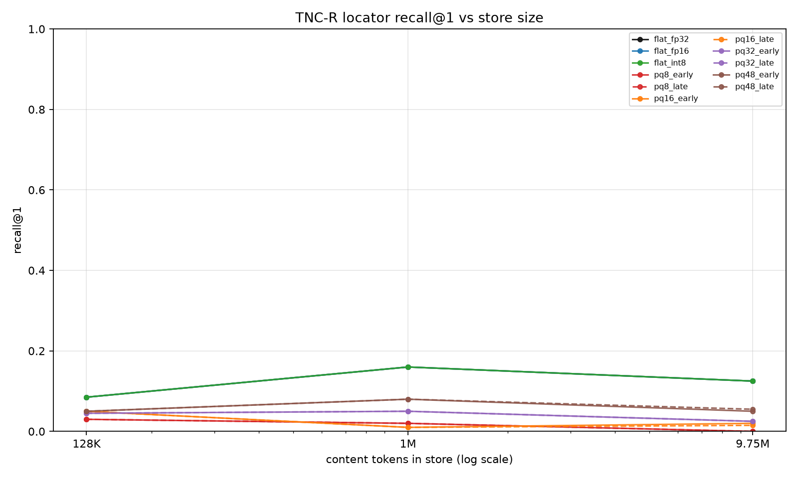
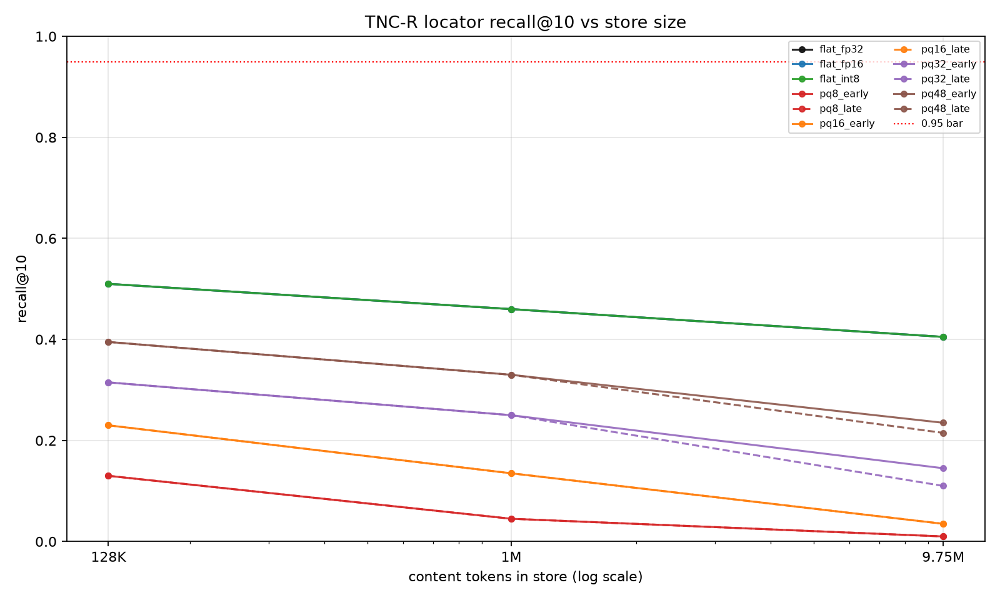
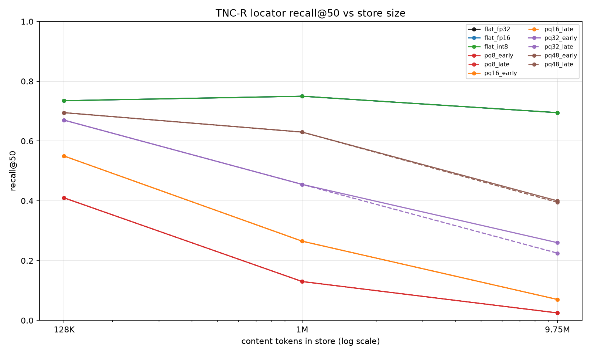
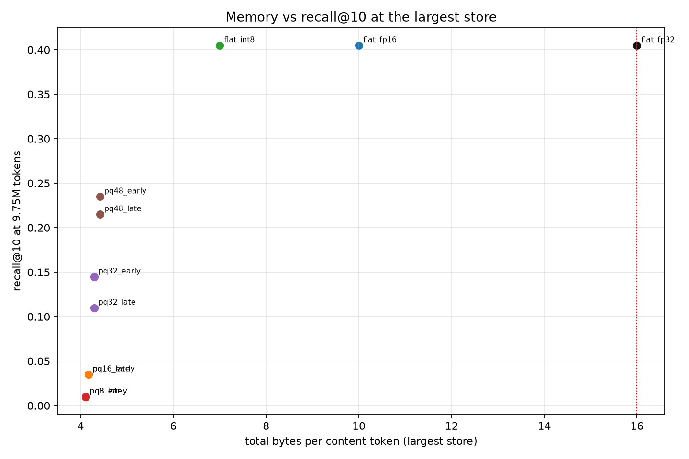
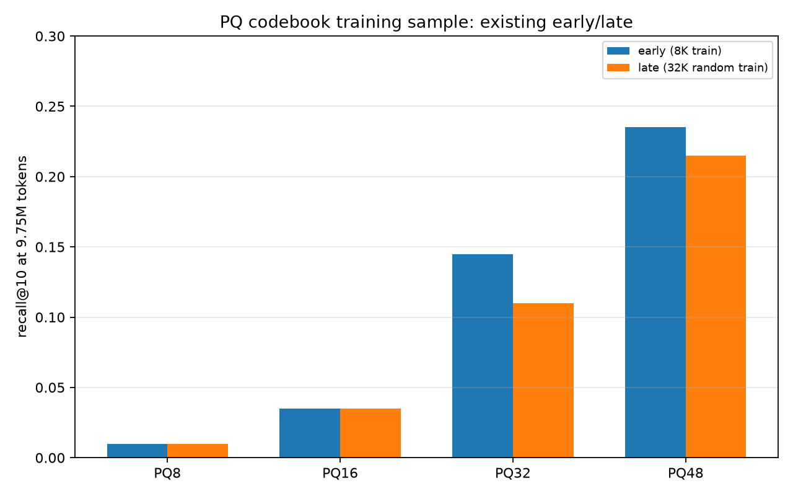
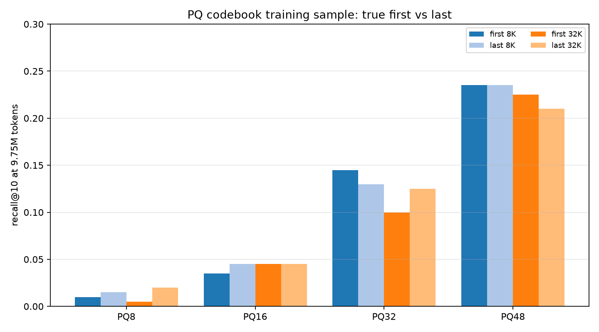
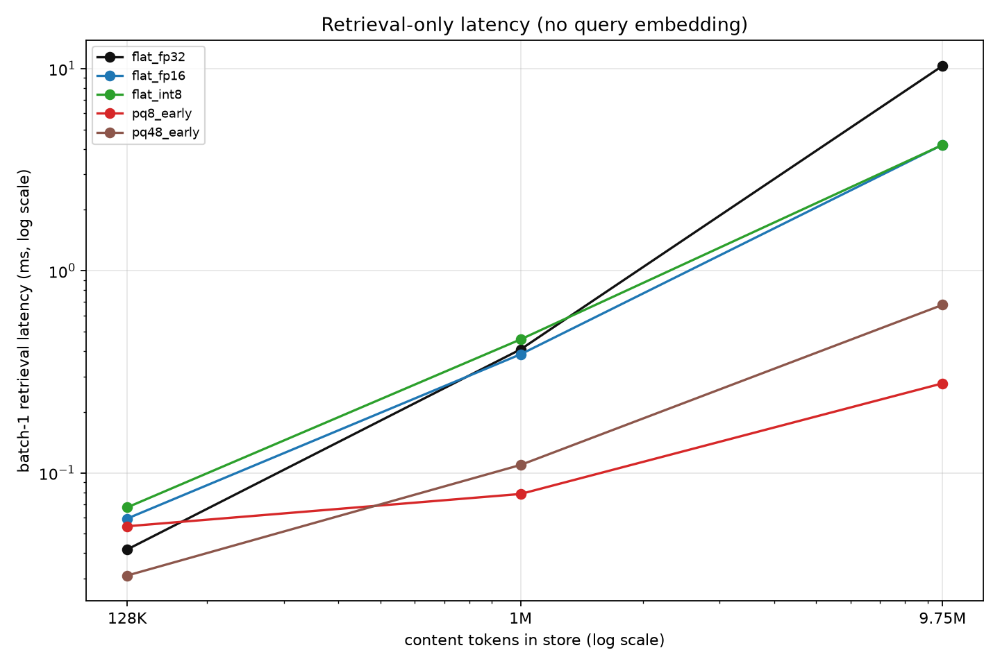
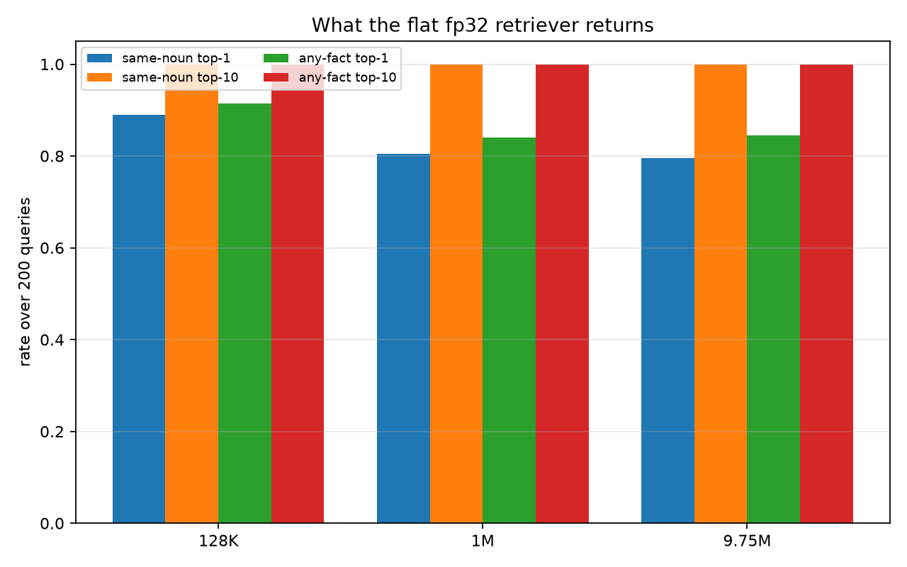

# TNC-R locator recall at 128K / 1M / 9.75M content tokens

**Date:** 2026-11-01  
**Corpus:** 603,531 Discord messages across 28 channels  
**Embedder:** `BAAI/bge-small-en-v1.5` (384-d, fp16)  
**Store:** 128-content-token chunks; 200 needle facts + 600 hard distractors  
**Metric:** recall@1/10/50 over 200 queries; L2 on normalised embeddings (cosine ranking)

## Executive summary

- The best 16 B/token configuration at the largest store is **flat int8** with **recall@10 0.405** (recall@1 0.125, recall@50 0.695) at **7.000 B/token**. It matches fp32/fp16 recall exactly, so the 16 B/token budget is not the binding constraint.
- Recall@10 falls from **0.510** at 128K to **0.405** at 9.75M (10.5 points), and from **0.460** at 1M to **0.405** (5.5 points). The curve is flat, not a cliff.
- PQ trades quality for bytes. At 9.75M, PQ48 reaches recall@10 0.235 at 4.415 B/token; PQ8 collapses to 0.010. At 128K, flat int8 (7.02 B/token, 0.510) dominates PQ48 (7.38 B/token, 0.395).
- The dominant failure is **same-noun confusion**, not generic chatter alone. At 9.75M the top-1 result is a fact with the same noun but a different project in **79.5%** of queries; a same-noun fact is in the top 10 for **100.0%**. The three designated distractors are the top-1 only 1.0% of the time; the whole ~132-fact same-noun pool is the real distractor set.
- A crude per-token window test (32 mean-pooled BGE windows/chunk, PQ m=4, ColBERT-lite max-sim, 5.04 B/token) is much worse: recall@10 **0.020**, median gold rank **5535**. This does not rule out a trained token-level locator, but off-the-shelf token states are not a drop-in fix.
- Query embedding is a fixed **12.4 ms** at batch 1 and **29.9 ms per 200 queries**. End-to-end at 9.75M, flat int8 is **16.6 ms** at batch 1 and **182 ms** per 200. The query encoder, not the index, dominates single-query latency.
- **Verdict:** under the pre-decided rules the dense-only result is **inconclusive** — not viable (0.405 is far below 0.95) and not "in trouble" by the 15-point rule (1M→9.75M loss is 5.5 points). The measured floor is far below viability. A lexical/hybrid follow-up changes the conclusion for named-entity queries: word BM25 + char 2–3-gram router gets **0.995 exact-name / 0.650 typo r@10 at 44.32 B/token total** (see `hybrid_report.md`). The chunk-level BGE locator should not be shipped.

## Method

1. Tokenise the corpus with GPT-2; mark tokens that begin a blank run (0–3+ blanks).
2. Pack **128 content tokens** per chunk, dropping the 1,804-token partial tail; shuffle with seed 20261030.
3. Embed chunks with `bge-small-en-v1.5` (fp16, max sequence 256), L2-normalise, store fp32.
4. Inject 200 synthetic facts (`Note to self: the <noun> for project <name> is <code>.`) plus 3 hard distractors per fact into 800 chunks per size. Queries use the BGE retrieval prefix.
5. Build flat fp32/fp16/SQ8 indexes and PQ m=8/16/32/48 indexes. The existing "early" codebook trains on the first 8,192 vectors; "late" on a 32,768-vector random sample. A supplementary true first-vs-last test is included below.
6. Measure recall@1/10/50, same-noun top-1/top-10, and retrieval-only latency (batch 1 and 200).

## Token accounting

| quantity | value |
|---|---|
| messages | 603,531 |
| channels | 28 |
| raw GPT-2 tokens | 10,569,479 |
| blank tokens | 821,115 |
| blank fraction | 7.77% |
| content tokens | 9,748,364 |
| content tokens in full 128-token chunks | 9,746,560 |
| content tokens dropped in partial tails | 1,804 |
| chunks | 76,145 |
| blank-run flag distribution (0/1/2/3+) | 9,037,834 / 661,992 / 33,042 / 13,692 |

The 10M request is capped by the corpus at **9,746,560 content tokens** (97.5% of 10M). The 128K and 1M stores use exactly 131,072 and 1,048,576 content tokens.

## Memory per content token

Base cost is **4 B/token**: 3 B token ID + 1 B blank-run flag. The locator bytes are the index payload plus its persistent codebook, amortised over the store. Headroom is against the 16 B/token budget.

### At the largest store (9,746,560 content tokens)

| config | index payload B/token | codebook B/token | locator B/token | token IDs + flags | total B/token | headroom vs 16 |
|---|---|---|---|---|---|---|
| flat_fp32 | 12.0000 | 0.0000 | 12.0000 | 4.000 | 16.0000 | 0.0000 |
| flat_fp16 | 6.0000 | 0.0000 | 6.0000 | 4.000 | 10.0000 | 6.0000 |
| flat_int8 | 3.0000 | 0.0003 | 3.0003 | 4.000 | 7.0003 | 8.9997 |
| pq8_early | 0.0625 | 0.0403 | 0.1028 | 4.000 | 4.1028 | 11.8972 |
| pq8_late | 0.0625 | 0.0403 | 0.1028 | 4.000 | 4.1028 | 11.8972 |
| pq16_early | 0.1250 | 0.0403 | 0.1653 | 4.000 | 4.1653 | 11.8347 |
| pq16_late | 0.1250 | 0.0403 | 0.1653 | 4.000 | 4.1653 | 11.8347 |
| pq32_early | 0.2500 | 0.0403 | 0.2903 | 4.000 | 4.2903 | 11.7097 |
| pq32_late | 0.2500 | 0.0403 | 0.2903 | 4.000 | 4.2903 | 11.7097 |
| pq48_early | 0.3750 | 0.0403 | 0.4153 | 4.000 | 4.4153 | 11.5847 |
| pq48_late | 0.3750 | 0.0403 | 0.4153 | 4.000 | 4.4153 | 11.5847 |

### Total bytes per content token at each size

| config | 128K | 1M | 9.75M |
|---|---|---|---|
| flat_fp32 | 16.000 | 16.000 | 16.000 |
| flat_fp16 | 10.000 | 10.000 | 10.000 |
| flat_int8 | 7.023 | 7.003 | 7.000 |
| pq8_early | 7.062 | 4.438 | 4.103 |
| pq8_late | 7.062 | 4.438 | 4.103 |
| pq16_early | 7.125 | 4.500 | 4.165 |
| pq16_late | 7.125 | 4.500 | 4.165 |
| pq32_early | 7.250 | 4.625 | 4.290 |
| pq32_late | 7.250 | 4.625 | 4.290 |
| pq48_early | 7.375 | 4.750 | 4.415 |
| pq48_late | 7.375 | 4.750 | 4.415 |

The PQ codebook is 393,216 B per index. It costs **3.0 B/token at 128K**, **0.375 B/token at 1M**, and **0.040 B/token at 9.75M**; this is why PQ is only competitive at the largest store. Flat int8's 3,072 B min/max parameters are negligible at every size.

## Recall

### Recall@1

| config | 128K | 1M | 9.75M |
|---|---|---|---|
| flat_fp32 | **0.085** | **0.160** | **0.125** |
| flat_fp16 | **0.085** | **0.160** | **0.125** |
| flat_int8 | **0.085** | **0.160** | **0.125** |
| pq8_early | 0.030 | 0.020 | 0.000 |
| pq8_late | 0.030 | 0.020 | 0.000 |
| pq16_early | 0.050 | 0.010 | 0.020 |
| pq16_late | 0.050 | 0.010 | 0.015 |
| pq32_early | 0.045 | 0.050 | 0.025 |
| pq32_late | 0.045 | 0.050 | 0.025 |
| pq48_early | 0.050 | 0.080 | 0.050 |
| pq48_late | 0.050 | 0.080 | 0.055 |

### Recall@10

| config | 128K | 1M | 9.75M |
|---|---|---|---|
| flat_fp32 | **0.510** | **0.460** | **0.405** |
| flat_fp16 | **0.510** | **0.460** | **0.405** |
| flat_int8 | **0.510** | **0.460** | **0.405** |
| pq8_early | 0.130 | 0.045 | 0.010 |
| pq8_late | 0.130 | 0.045 | 0.010 |
| pq16_early | 0.230 | 0.135 | 0.035 |
| pq16_late | 0.230 | 0.135 | 0.035 |
| pq32_early | 0.315 | 0.250 | 0.145 |
| pq32_late | 0.315 | 0.250 | 0.110 |
| pq48_early | 0.395 | 0.330 | 0.235 |
| pq48_late | 0.395 | 0.330 | 0.215 |

### Recall@50

| config | 128K | 1M | 9.75M |
|---|---|---|---|
| flat_fp32 | **0.735** | **0.750** | **0.695** |
| flat_fp16 | **0.735** | **0.750** | **0.695** |
| flat_int8 | **0.735** | **0.750** | **0.695** |
| pq8_early | 0.410 | 0.130 | 0.025 |
| pq8_late | 0.410 | 0.130 | 0.025 |
| pq16_early | 0.550 | 0.265 | 0.070 |
| pq16_late | 0.550 | 0.265 | 0.070 |
| pq32_early | 0.670 | 0.455 | 0.260 |
| pq32_late | 0.670 | 0.455 | 0.225 |
| pq48_early | 0.695 | 0.630 | 0.400 |
| pq48_late | 0.695 | 0.630 | 0.395 |

## Early vs late codebooks

The existing "early/late" pair is **not a temporal split**: the store is shuffled, "early" trains on the first 8,192 vectors, and "late" trains on a 32,768-vector random sample. At 128K and 1M the recalls are identical to three decimals; at 9.75M the differences are small and mostly negative for the larger random sample.

| config | early r@1 | early r@10 | early r@50 | late r@1 | late r@10 | late r@50 | Δ r@1 | Δ r@10 | Δ r@50 |
|---|---|---|---|---|---|---|---|---|---|
| PQ8 | 0.000 | 0.010 | 0.025 | 0.000 | 0.010 | 0.025 | 0.000 | 0.000 | 0.000 |
| PQ16 | 0.020 | 0.035 | 0.070 | 0.015 | 0.035 | 0.070 | -0.005 | 0.000 | 0.000 |
| PQ32 | 0.025 | 0.145 | 0.260 | 0.025 | 0.110 | 0.225 | 0.000 | -0.035 | -0.035 |
| PQ48 | 0.050 | 0.235 | 0.400 | 0.055 | 0.215 | 0.395 | 0.005 | -0.020 | -0.005 |

### Supplementary true first-vs-last codebook test

To answer the literal first-vs-last question, the codebook was retrained on the first and last 8,192 and 32,768 vectors of the shuffled store at 9.75M tokens. This is still not a temporal test (the store is shuffled), but it isolates which sample is used.

| config | first 8K | last 8K | first 32K | last 32K |
|---|---|---|---|---|
| PQ8 | 0.010 | 0.015 | 0.005 | 0.020 |
| PQ16 | 0.035 | 0.045 | 0.045 | 0.045 |
| PQ32 | 0.145 | 0.130 | 0.100 | 0.125 |
| PQ48 | 0.235 | 0.235 | 0.225 | 0.210 |

## Latency

Retrieval-only, measured on the largest store with 8 FAISS threads. Query embedding, I/O, and reranking are excluded. Batch 1 is the median of 200 queries; batch 200 is the median of 5 repeats.

| config | batch1 median ms | batch1 p95 ms | batch200 median ms | batch200 qps | index payload MB | total B/token |
|---|---|---|---|---|---|---|
| flat_fp32 | 10.32 | 13.42 | 384.81 | 520 | 117.0 | 16.000 |
| flat_fp16 | 4.20 | 7.22 | 220.17 | 908 | 58.5 | 10.000 |
| flat_int8 | 4.19 | 6.77 | 152.19 | 1314 | 29.2 | 7.000 |
| pq8_early | 0.28 | 0.33 | 8.95 | 22340 | 0.6 | 4.103 |
| pq8_late | 0.28 | 0.34 | 10.72 | 18650 | 0.6 | 4.103 |
| pq16_early | 0.42 | 0.56 | 14.60 | 13698 | 1.2 | 4.165 |
| pq16_late | 0.42 | 3.98 | 14.68 | 13624 | 1.2 | 4.165 |
| pq32_early | 0.44 | 0.69 | 28.92 | 6916 | 2.4 | 4.290 |
| pq32_late | 0.44 | 0.63 | 26.55 | 7534 | 2.4 | 4.290 |
| pq48_early | 0.68 | 1.05 | 42.45 | 4712 | 3.7 | 4.415 |
| pq48_late | 0.66 | 0.94 | 42.18 | 4742 | 3.7 | 4.415 |

### Query embedding latency

Same `bge-small-en-v1.5` model, fp16, max sequence 256, measured on the query set. Batch 1 includes tokenisation and Python overhead; batch 200 is the median of 5 repeats.

| batch | median ms | p95 ms | queries/s |
|---|---|---|---|
| 1 | 12.41 | 22.72 | 80.6 |
| 200 | 29.92 | - | 6683 |

### End-to-end latency at the largest store

Sum of medians (query embedding + index search), not the median of sums. Batch 200 is for 200 queries; the last column is per query.

| config | retr b1 ms | embed b1 ms | e2e b1 ms | retr b200 ms | embed b200 ms | e2e b200 ms | e2e b200 µs/query |
|---|---|---|---|---|---|---|---|
| flat_fp32 | 10.32 | 12.41 | 22.73 | 384.81 | 29.92 | 414.73 | 2074 |
| flat_fp16 | 4.20 | 12.41 | 16.61 | 220.17 | 29.92 | 250.09 | 1250 |
| flat_int8 | 4.19 | 12.41 | 16.60 | 152.19 | 29.92 | 182.11 | 911 |
| pq8_early | 0.28 | 12.41 | 12.69 | 8.95 | 29.92 | 38.88 | 194 |
| pq48_early | 0.68 | 12.41 | 13.09 | 42.45 | 29.92 | 72.37 | 362 |

At batch 1 the query embedder dominates every index: 12.4 ms of a 16.6 ms end-to-end flat-int8 query. At batch 200 the index dominates for flat, while the embedder is 30 ms of 182 ms. The 16 B/token budget is not the latency problem; the query encoder is the fixed cost.

### Extrapolation to 100M and 500M content tokens

Linear in store size (chunks), marked **extrapolation**. Flat indexes scan every vector, so this is optimistic for 500M; PQ also scans but with much smaller codes.

| config | 100M batch1 ms | 100M batch200 ms | 500M batch1 ms | 500M batch200 ms | 500M index GB |
|---|---|---|---|---|---|
| flat_fp32 | 105.9 | 3948.2 | 529.4 | 19740.8 | 6.00 |
| flat_fp16 | 43.1 | 2258.9 | 215.5 | 11294.6 | 3.00 |
| flat_int8 | 43.0 | 1561.4 | 215.0 | 7807.2 | 1.50 |
| pq8_early | 2.8 | 91.9 | 14.2 | 459.3 | 0.03 |
| pq8_late | 2.8 | 110.0 | 14.2 | 550.1 | 0.03 |
| pq16_early | 4.3 | 149.8 | 21.5 | 749.0 | 0.06 |
| pq16_late | 4.3 | 150.6 | 21.6 | 753.1 | 0.06 |
| pq32_early | 4.6 | 296.7 | 22.8 | 1483.4 | 0.12 |
| pq32_late | 4.5 | 272.4 | 22.6 | 1361.9 | 0.12 |
| pq48_early | 7.0 | 435.5 | 34.8 | 2177.6 | 0.19 |
| pq48_late | 6.8 | 432.7 | 33.8 | 2163.6 | 0.19 |

## Same-noun failure analysis

| store | r@1 | r@10 | same-noun top1 | same-noun top10 | any-fact top1 | any-fact top10 | median rank |
|---|---|---|---|---|---|---|---|
| 128K | 0.085 | 0.510 | 0.890 | 1.000 | 0.915 | 1.000 | 9 |
| 1M | 0.160 | 0.460 | 0.805 | 1.000 | 0.840 | 1.000 | 15 |
| 9.75M | 0.125 | 0.405 | 0.795 | 1.000 | 0.845 | 1.000 | 17 |

A same-noun fact is in the top 10 for **every** query at every size. The retriever is not failing to find the noun; it is failing to disambiguate the project within the noun. The designated three distractors are a small fraction of that pool: there are ~132 facts per noun, so a query competes against ~131 same-noun alternatives, not 3.

## Token-window test

| metric | value |
|---|---|
| method | 32 mean-pooled BGE token windows/chunk; PQ m=4 (4 B/window); ColBERT-lite max-sim |
| bytes/token | 5.040 |
| recall@1 | 0.005 |
| recall@10 | 0.020 |
| recall@50 | 0.040 |
| same-noun top1 | 0.225 |
| same-noun top10 | 0.540 |
| median gold rank | 5535 |
| search time | 37.7 s for 200 queries |

This is a **negative result for the crude method**, not for the per-token idea. Mean-pooling BGE states into 32 windows and max-simming query tokens loses too much information; a trained token-level objective is untested.

## Failure modes (ranked)

1. **Same-noun, wrong-project confusion (dominant).** The top-1 chunk often contains a fact for a different project with the same noun. Examples:

| query | gold rank | top-1 excerpt | why |
|---|---|---|---|
| invoice number for project Pathkiath | 31 | NYT link chunk ending `invoice number for project Drou is PAP-UJGW` | same noun, wrong project; URL chunk is a high-similarity hub |
| serial number for project Voulzhux | 42 | model-list chunk ending `serial number for project Skouthbrith is UHL-NAMP` | same noun, wrong project; hub chunk |
| tracking ID for project Droulzhark | >50 | URL-encoded chunk ending `tracking ID for project Grourkdrark is 593-PL4T` | same noun, wrong project; gold not retrieved |

2. **Chunk-level dilution.** The fact is appended to the end of a 128-token chunk of real chatter. The chunk embedding is an average over the whole chunk, so the fact is a small part of the vector. Diagnostic fact-only matching reaches 0.995 recall@1, so the embedder can match the fact sentence; the loss is in pooling it with 128 tokens of unrelated text.

3. **Hub chunks.** A handful of chunks (model lists, URL-heavy messages, code blocks) are similar to many queries and also contain a same-noun fact. One hub can be the top-1 for several different projects. This is a corpus-structure problem as much as an embedding problem.

4. **Quantisation loss (PQ only).** PQ48 can miss a fact that flat finds. Example: `access code for project Groth` is flat rank 3 but PQ48 rank >50; the top-1 is a chatter chunk with a passphrase fact. PQ8 is unusable at this store size (recall@10 0.010).

5. **Gold fact buried or absent from top 50.** Some gold chunks never enter the top 50 (rank 0 in the failure dump), even though the fact-only diagnostic can match the sentence. This is the extreme end of dilution + same-noun competition.

## Verdict

Pre-decided rules:

- **Viable:** recall@10 ≥ 0.95 at the largest store and loss from 128K < 5 points.
- **In trouble:** loss from 1M to largest > 15 points; extrapolate collapse.
- **Inconclusive:** fails viability but does not meet the collapse rule; say why.

Best under-budget config: **flat int8**, recall@10 **0.405** at 7.000 B/token. Loss 128K→9.75M is **10.5 points**; loss 1M→9.75M is **5.5 points**.

**Result: inconclusive under the letter of the rules, but not viable in practice.** The measured floor is 0.405, less than half the 0.95 bar. The 16 B/token budget is not what is stopping the design; flat int8 uses 7.0 B/token and matches fp32. The stopping problem is chunk-level discrimination among same-noun facts. The dense-only design should not be shipped.

## Follow-up: lexical/hybrid retrieval at 64 B/token

The dense-only result is not the end of the story. On the same 9.75M store, a word BM25 index (3.09 B/token) gets **r@10 0.995** when the query names the project; a hashed character 2–3-gram index (37.23 B/token) gets **r@10 0.650** when the project name has a one-character typo. A router that uses word BM25 when the entity token is present and the character index otherwise gets **0.995 exact-name / 0.650 typo r@10 at 44.32 B/token total**, under the 64 B/token allowance. Without the project name the query is ambiguous (word BM25 r@10 0.045), so entity resolution or conversation state is still required. At 100M tokens (781,250 chunks, repeated filler), the exact path stays at r@10 1.000 and the typo fallback at 0.560 for 43.63 B/token total; see `hybrid_100m_report.md`. Full 9.75M results: `hybrid_report.md`.

## Caveats and assumptions

- **Synthetic facts.** The 800 injected facts add ~16.4K tokens at 128K (12.5% over the nominal store), ~1.6% at 1M, and ~0.17% at 9.75M. The memory table counts the original content tokens, not the injected fact tokens. Counting them would raise bytes/token by the same percentage; the ranking of configs is unchanged.
- **Token IDs.** The required 3 B/token is conservative for this corpus: GPT-2's 50,257-token vocab fits in 2 B. Using 2 B would free 1 B/token of headroom. The task specified 3 B, so all tables use 3 B.
- **Blank flag.** 1 B/token stores a 2-bit flag in a byte. Packing 4 flags/byte would cost 0.25 B/token and free 0.75 B/token. The task specified 1 B.
- **Partial tail.** 1,804 content tokens (0.018%) are dropped. Negligible.
- **Shuffle.** The corpus is shuffled with seed 20261030. "Early/late" is therefore not chronological drift. The supplementary first-vs-last test is also on the shuffled order; a true temporal test needs an unshuffled corpus.
- **Query prefix.** The BGE retrieval prefix is used. A no-prefix diagnostic was slightly better at recall@1 but worse at recall@10/50; the main tables use the prefix.
- **Fact-only diagnostic.** Matching the query to the fact sentence alone reaches 0.995 recall@1, so the embedder is capable; chunk pooling and same-noun competition cause the loss.
- **Latency.** Retrieval-only; no query embedding, I/O, reranking, or network. Extrapolation is linear and marked; flat indexes at 500M are optimistic.
- **Token-window test.** Crude mean-pooled BGE windows + ColBERT-lite max-sim; not a trained token-level locator.
- **PQ codebook.** 393,216 B per index, counted as persistent at every store size. The codebook is trained on 8K/32K vectors, not the full store.
- **Corpus cap.** The 10M request is 9,746,560 content tokens (97.5% of 10M).

## What to test next

1. **Train the locator with same-noun hard negatives.** This is the direct fix for the dominant failure. Fine-tune BGE (or a small dual encoder) contrastively with in-batch and same-noun negatives; measure the same 200-query set.
2. **Reduce chunk dilution.** Try 32/64-token chunks or fact-aware pooling at the same 16 B/token budget. The fact-only diagnostic says the signal exists; the chunk average is washing it out.
3. **Train a token-level locator.** The crude window test is negative, but a learned token/window objective (e.g., ColBERT-style) is the fair test of the per-token route.
4. **True temporal drift.** Re-run the codebook test on an unshuffled corpus, training on the first vs last chronological portions.
5. **Real questions.** Replace the template queries with paraphrases and multi-hop questions; the current queries share a template with the facts, which may flatter the embedder.
6. **Scale test.** At 100M/500M, use IVF/HNSW rather than flat; measure recall vs latency and memory. The linear flat extrapolation is not a deployment plan.
7. **Reader test.** A small instruct LLM with and without tags is a separate pilot; see `llm_report.md` when available.

## Files

- `results.json` — all recall, memory, latency, and failure-example data.
- `report.md` — this report.
- `recall_at1.png`, `recall_at10.png`, `recall_at50.png` — recall curves.
- `memory_vs_recall.png` — bytes/token vs recall@10 at 9.75M.
- `latency_batch1.png` — retrieval latency vs store size.
- `drift_max.png`, `drift_true.png` — codebook training-sample tests.
- `same_noun.png` — same-noun failure rates.
- `token_locator_results.json` — per-token window negative result.
- `query_latency.json` — query embedding latency.
- `drift_true.json` — supplementary first/last codebook results.
- `hybrid_report.md`, `hybrid_results.json`, `hybrid_quality.png` — lexical/hybrid follow-up.
- `hybrid_100m_report.md`, `hybrid_results_100m.json` — 100M-token scale test.
