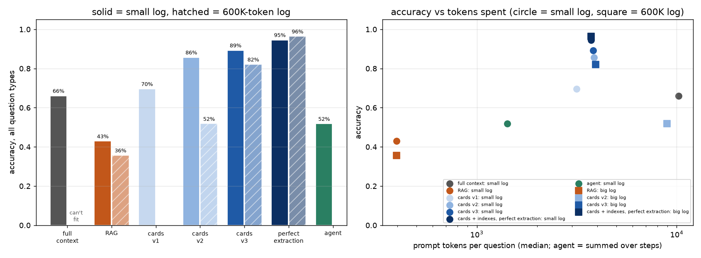
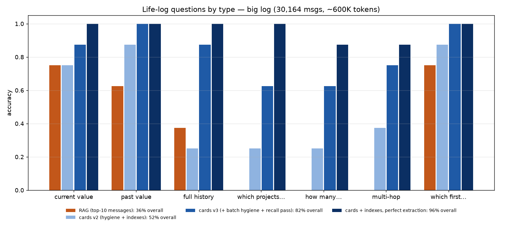
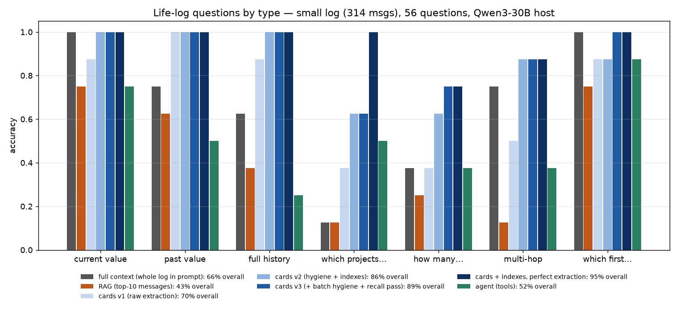

# Memory that behaves like context: the life-log eval

**Headline.**
- On a 600K-token log that cannot fit in any context window here, the memory layer answers **82%** of context-style questions: current/past values, full histories, "which projects…", "how many…", multi-hop and ordering. Plain RAG gets **36%**.
- On a small log where true full context is possible, the memory layer scores **89%** and putting the whole log in the prompt scores **66%**, so the memory is **better than real context** on this kind of question, at about 40% of the tokens.
- With perfect extraction the same design scores 95–96% on both logs, so what's left is extraction quality, not the design.

## Why this eval exists

The v2 numbers (0.99 on the 9.75M store, 0.95 r@1 on real messages) are all single-fact lookups. RAG is good at single-fact lookup, so those numbers can't tell a memory layer from plain RAG. Things that only context could do were never tested:
- facts that **change** (which value is current?),
- questions over **many facts at once**,
- **chains** of facts,
- **time** (which came first?).

## The test world (`scripts/life_log.py`)

- **16 invented projects over 10 months** (2026-01-05 to 2026-10-30), with 146 events.
  - Ports move, databases migrate, hosts change, projects pause, resume, ship or die, and people join and leave.
- **Messages are casual and varied.** About 40% of some event types are a lead message plus a follow-up that only says "it", e.g. "Zephram stuff today" then "and it's on Redis now instead of Postgres".
- **The events are buried in real Discord chatter** (filler stays local, never committed):
  - **small log:** 314 messages, about 10K prompt tokens, so it fits in a context window;
  - **big log:** 30,164 messages, about 600K tokens.
- **Same seed for both logs**, so the projects, events and questions are identical. The gold answers come from the event log.
- **Seven question types**, 8 of each = 56 questions:
  - current value: "What port is Drisk on right now?"
  - past value: "Before Quillon's host was basalt, what was it?"
  - full history: "List every host Ferrow has had, oldest first."
  - which projects: "Which projects use Postgres right now?"
  - how many: "How many of my projects are paused right now?"
  - multi-hop: "What language is the project currently on port 5035 written in?"
  - which first: "Which did I start first, Umbrin or Zephram?"
- **Scoring is strict:**
  - sets must match exactly, with no extras;
  - histories must match in order;
  - counts must be the exact number.

## The memory layer (`scripts/lifelog_memory.py`)

1. **Write-time extraction.**
   - The host LLM reads every message once, as it arrives.
   - Output is constrained by a grammar to one line per message, e.g. `Drisk port=7764` or `-`. This makes looping impossible and keeps decode short.
   - On the big log, a keyword/project-name gate sends 11% of messages to the extractor.
2. **A fact store with history.** Each `(project, attribute)` keeps every dated value. Newer facts replace older ones, and collaborators are tracked as joins and leaves.
3. **Hygiene.** These are general rules; every one was added because of a specific failure seen in this eval.

   | rule | failure it fixes |
   |---|---|
   | a value must appear in its message (or the same author's adjacent message); near-misses snap to the message's spelling, allowing 1 edit below 8 characters | "MaraiDB", "quokka_box", a hallucinated host "spark" |
   | a project starts once, only in a message that names it, and only when **the user** introduces it | re-emitted starts; other people's "started using Qwen3" making Qwen a project |
   | the user is never their own collaborator | "daniel" listed on his own projects |
   | facts from a message that doesn't name its project go to the project its author last named | Mirevale's port landing on Zephram |
   | **realignment:** a fact whose value isn't in its message moves to the nearby message that has the value and names the project | in noisy batches the model wrote a message's facts on a neighbouring line |
   | **value typing:** a value seen mostly as one attribute can't be another | the host "basalt" stored as a database 4 times |
   | an old value restated in the same message ("off kestrel onto ironbark") isn't a change | phantom moves back and forth |
   | pronouns and filler words are never project names | "it" became a project on the big log |
   | **recall pass:** project messages that left nothing in the store are re-read in batches of 3 | missed facts, including an entire project (Umbrin) on the big log |

4. **Cards and indexes.**
   - **Cards:** one line per project, with current values, what they were before, and when they changed.
   - **Indexes:** the projects grouped by status, database, language and host; a port-to-project map; who works on what; start order; and totals.
   - Together they come to about 3.8K tokens for 16 projects, the same size whether the log is 7K or 600K tokens.
   - The indexes turn "which", "how many" and "which first" into lookups instead of the model scanning cards in its head.

## Results (Qwen3-30B-A3B-Thinking Q4_K_M host)

| condition | small log (~10K tok) | 600K-token log | prompt tokens |
|---|---:|---:|---:|
| full context (whole log in the prompt) | 0.66 | can't fit | 10,240 |
| RAG, top-10 messages (hybrid + rerank) | 0.43 | **0.36** | 396 |
| cards v1 (raw extraction, no indexes) | 0.70 | — | 3,158 |
| cards v2 (hygiene + indexes) | 0.86 | 0.52 | 3,850 / 8,944 |
| **cards v3** (+ batch hygiene + recall pass) | **0.89** | **0.82** | ~3,850 |
| cards + indexes, **perfect extraction** | 0.95 | 0.96 | ~3,720 |
| agent (tool loop, v2 store) | 0.52 | — | 1,419 (summed) |

By question type, v3:

| | current | past | history | which | how many | multi-hop | which first |
|---|---:|---:|---:|---:|---:|---:|---:|
| small log | 1.00 | 1.00 | 1.00 | 0.63 | 0.75 | 0.88 | 1.00 |
| 600K log | 0.88 | 1.00 | 0.88 | 0.63 | 0.63 | 0.75 | 1.00 |
| full context, small log | 1.00 | 0.75 | 0.63 | 0.13 | 0.38 | 0.75 | 1.00 |
| RAG, 600K log | 0.75 | 0.63 | 0.38 | 0.00 | 0.00 | 0.00 | 0.75 |

**Extraction quality** (store vs. the gold event log, 112 values):

| | raw extraction | + v2 hygiene | + v3 hygiene + recall |
|---|---:|---:|---:|
| small, current values right | 0.89 | 0.96 | 0.96 |
| small, histories exactly right | 0.84 | 0.94 | 0.96 |
| 600K, current values right | 0.66 | 0.75 | **0.91** |
| 600K, histories exactly right | 0.59 | 0.71 | **0.92** |
| 600K, junk entities | 36 | 30 | **0** |

## What it means

1. **Consolidated memory beats full context on these questions.**
   - With every message in front of it, the model gets 13% on "which projects" and 38% on counting. It can't reliably work out which values are still current across 300 messages.
   - The memory does that work once, at write time, so the model reads a clean current state.
2. **It holds up at scale.**
   - From the 10K-token log to the 600K-token log, v3 goes from 0.89 to 0.82, and with perfect extraction 0.95 to 0.96.
   - RAG falls to 0% on "which", "how many" and multi-hop as the chatter grows.
3. **Extraction is now the bottleneck.**
   - Raw LLM extraction on the 600K log got only 66% of values right. Real chatter confuses the line alignment and creates junk projects.
   - The hygiene rules and recall pass took that to 91%, and **every point of extraction accuracy showed up in answer accuracy**: 0.52 → 0.82.
4. **The indexes fixed reasoning failures.** With perfect extraction but no indexes, the model got 0.50 on "which projects" and 0.38 on multi-hop. With indexes, 1.00 and 0.88.
5. **Agent mode doesn't work with this model.**
   - The Thinking checkpoint deliberates for 400+ tokens about which tool to use.
   - Capping its notes with a grammar made it act, but badly (0.52).
   - With no notes at all, or with the first call forced, it scores 0–1 of 26 on the questions it failed: it picks the wrong tool, e.g. `find_projects(name, X)`.
   - The cards and indexes do the job without tool use.

## Cost

- **Writing memory** (once per message, 600K-token log, this PC):
  - 343 extraction calls plus 9 recall calls, about 1 hour at normal speed;
  - search index (bge + BM25) about 6.5 min.
  - That's about 1.5–2 h per 1M tokens, almost all of it LLM prefill: the 18.5 GB model doesn't fit in free RAM, so experts are re-read from disk on every prompt (~36 tok/s prefill).
  - A host that fits in memory should be about 10× faster. A small fine-tuned extractor would be faster still: the output format is fixed and the hygiene rules catch its mistakes.
- **Reading memory:** about 3.8K prompt tokens per question, flat in log size, against 10K for the small log's full context and 600K+ for the big log's.

## Caveats

- **Synthetic events.** The event messages are templated (varied, casual, with pronoun follow-ups); the filler is real Discord chatter.
  - The gate's keywords and the extractor's schema (7 project attributes) were written knowing the domain.
  - **This tests memory for a typed domain.** Open-ended facts (decisions, reasons, preferences) still fall back to message search, which is what RAG scored here.
- **The hygiene rules were developed on the same two logs** they are scored on, from failures seen there. They are general rules, but there is no held-out third log yet, so treat the v3 extraction numbers as optimistic until one exists.
- **8 questions per type,** so one question is 12.5 points within a type.
- **The host is a reasoning checkpoint used without its think block.** It reasons out loud anyway, so every condition reads its final `ANSWER:` line, with a forced continuation if it runs out of tokens. Every condition gets the same treatment.
- **Latency is this PC.** About 25 s per question, because the model reasons and experts thrash from disk. Part of the big-log extraction ran while CS2 was being played, and that time is excluded from the cost estimate.
