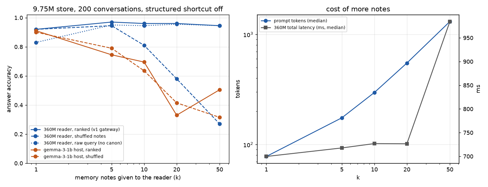

# Memory-note sweep: is 5 notes too few?

Question: does handing the reader more memory notes (top_k = 1, 5, 10, 20, 50) improve answers?

Short answer: **5 is the sweet spot for the 360M reader, and more context never helped it.** That reader isn't really reading. When the notes are shuffled its accuracy collapses, so it mostly copies note #1. A 1B general host (gemma-3-1b) was worse still: 0.91 at k=1 and 0.33 at k=20. So far no reader here benefits from more than 5 notes. A 7B+ host is the open test.

## Setup

- `scripts/topk_sweep.py`, gateway model path. **Both structured shortcuts are off** (the `fact_map` lookup and `structured_answer` on the top note), otherwise the reader never runs and k changes nothing.
- 9.75M-token store, the same 200 conversations as `gateway_975m_report.md` (100 pronoun, 50 explicit, 50 typo). Every fact has 3 same-noun distractor notes in the store.
- Noisy hard set: the 91 search rows of `hard_eval.jsonl` (real Discord chatter, 1-3 projects). The store holds only the 80 project notes.
- Retrieval is unchanged: BM25/char top 50, then cross-encoder rerank, then the top k go to the reader.
- **ranked** = notes in reranker order (what the gateway does). **shuffled** = the same k notes in random order.
- RTX 2060 6 GB, shared with other work during the run, so latency is noisy.

## Results, 9.75M benchmark (n = 200)

| k | accuracy | shuffled | gold in notes | prompt tokens (median / p95 / max) | total latency (median / p95) | reader (median) | GPU peak (process) |
|---:|---:|---:|---:|---:|---:|---:|---:|
| 1 | 0.920 | 0.920 | 0.970 | 78 / 82 / 85 | 700 / 839 ms | 498 ms | 1.33 GB |
| **5** | **0.970** | 0.945 | 0.980 | 175 / 183 / 188 | 718 / 861 ms | 523 ms | 1.33 GB |
| 10 | 0.960 | 0.810 | 0.980 | 297 / 307 / 414 | 727 / 892 ms | 545 ms | 1.33 GB |
| 20 | 0.960 | 0.580 | 0.980 | 550 / 562 / 668 | 727 / 876 ms | 545 ms | 1.33 GB |
| 50 | 0.945 | **0.270** | 1.000 | 1310 / 1528 / 2990 | 984 / 1185 ms | 802 ms | 2.61 GB |

## Results, noisy hard set (n = 91 search rows)

| k | accuracy | gold in notes | prompt tokens (median) | total latency (median / p95) |
|---:|---:|---:|---:|---:|
| 1 | 0.912 | 0.934 | 78 | 590 / 2613 ms |
| 5 | 0.934 | 0.956 | 176 | 656 / 3129 ms |
| 10 | 0.934 | 0.956 | 299 | 642 / 2772 ms |
| 20 | 0.934 | 0.978 | 558 | 1024 / 4741 ms |
| 50 | 0.934 | 1.000 | 1317 | 862 / 3055 ms |

## What it means

1. **k=1 to 5 helps (+5 points), past 5 nothing helps.** k=1 loses whenever the reranker's top note is wrong. At k=5 the gold note is almost always present, and accuracy given gold-present is 0.99.
2. **The 360M reader copies note #1.** With shuffled notes, accuracy falls from 0.945 (k=5) to 0.81, 0.58 and then 0.27 at k=50. It was trained on 4-6 notes per prompt, so long note lists are out of distribution for it.
3. **More notes cannot fix project-resolution errors in this gateway.** On the hard set, accuracy is flat at 0.934 from k=5 to 50, even though the gold note is in the list 100% of the time at k=50. The reason is that `canonical_from_note(notes[0])` rewrites the reader's question from the top note. A wrong top note means the wrong question, whatever else is in the list. The `--no-canon` run below tests this directly.
4. **Cost.** Prompt tokens grow linearly (78 to 1310 median, 2990 max at k=50). Latency is flat to k=20 because the reader generates at most 12 tokens and prefill is cheap at these sizes. At k=50 it rises about 40% and GPU peak doubles. Everything stays well under SmolLM2's 8192-token limit.

## Raw query instead of the top-note rewrite (`--no-canon`)

Same retrieval, but the reader gets the tool query (the user's wording, plus the project when a shortcut fired) instead of a question rewritten from note #1.

| k | 9.75M acc | 9.75M shuffled | hard acc | (canon, for comparison) |
|---:|---:|---:|---:|---:|
| 1 | 0.830 | 0.830 | 0.440 | 0.920 / 0.912 |
| 5 | 0.950 | 0.880 | 0.714 | 0.970 / 0.934 |
| 10 | 0.945 | 0.645 | 0.725 | 0.960 / 0.934 |
| 20 | 0.955 | 0.460 | 0.780 | 0.960 / 0.934 |
| 50 | 0.945 | 0.235 | 0.560 | 0.945 / 0.934 |

Without the rewrite, the 360M reader can't resolve references from the raw wording ("the other one's passphrase?"), and the noisy-set score falls to 0.44-0.78. **The rewrite was doing the reference resolution, not the reader.** That is why v2 resolves the entity *before* retrieval (`entity_tracker.py`) and hands the host an explicit "(the user is referring to project X)".

## Host model as the reader

`scripts/host_reader_sweep.py`: `memory_api.retrieve()` (tracker resolution, rerank) hands k notes plus "(the user is referring to project X)" to **gemma-3-1b-it Q4_K_M** in llama.cpp (CUDA, fully on GPU). The structured value is ignored, so the host has to read the notes.

| k | 9.75M acc | shuffled | hard acc | prompt tokens (median) | host latency (median) |
|---:|---:|---:|---:|---:|---:|
| 1 | 0.910 | 0.900 | 0.648 | 131 | 86 ms |
| 5 | 0.745 | 0.790 | 0.648 | 228 | 102 ms |
| 10 | 0.695 | 0.635 | 0.648 | 349 | 122 ms |
| 20 | 0.330 | 0.415 | 0.418 | 601 | 152 ms |
| 50 | 0.505 | 0.315 | 0.527 | 1357 | 236 ms |

**A 1B general model is a worse reader than the fine-tuned 360M.** Its errors are mostly over-refusal ("I don't know." with the value sitting in note 1), copy slips ("UN-SCC4" for "UNS-SCC4"), and answering with the note number. It does read rather than copy position (ranked and shuffled are close), but it gets confused as the list grows. So this run does **not** show that more context helps a real host. That needs a 7B+ instruction model. It also shows why `retrieve()` returns the exact `structured` value when there is one: no reader is the most reliable reader.

### Prefill and decode speed (gemma-3-1b, cold prompt, `cache_prompt=false`)

| k | prompt tokens | prefill | prefill time | decode |
|---:|---:|---:|---:|---:|
| 1 | 135 | 3,349 tok/s | 40 ms | 156 tok/s |
| 5 | 231 | 4,782 tok/s | 48 ms | 154 tok/s |
| 10 | 354 | 5,896 tok/s | 60 ms | 156 tok/s |
| 20 | 607 | 6,196 tok/s | 99 ms | 152 tok/s |
| 50 | 1,369 | 7,300 tok/s | 187 ms | 152 tok/s |
| 100 | 2,626 | 7,719 tok/s | 340 ms | 149 tok/s |

Prefill throughput *rises* with prompt length (bigger batches use the GPU better), so even 100 notes costs about a third of a second. For comparison, the 360M reader in HF transformers works out to about 4,000 tok/s prefill (derived from latency growth, not measured directly) and ~35-40 ms per decoded token. Context size is not the latency problem at these sizes. Decode overhead and reader quality are.

## Caveats

- Synthetic, typed notes. The structured lookup answers these 200/200 without any reader, so this sweep only measures the fallback path.
- Shared GPU: latency numbers are indicative, not benchmarks.
- `gpu_peak` is this process's `torch.cuda.max_memory_allocated`: 360M reader + 135M router + reranker + activations.
